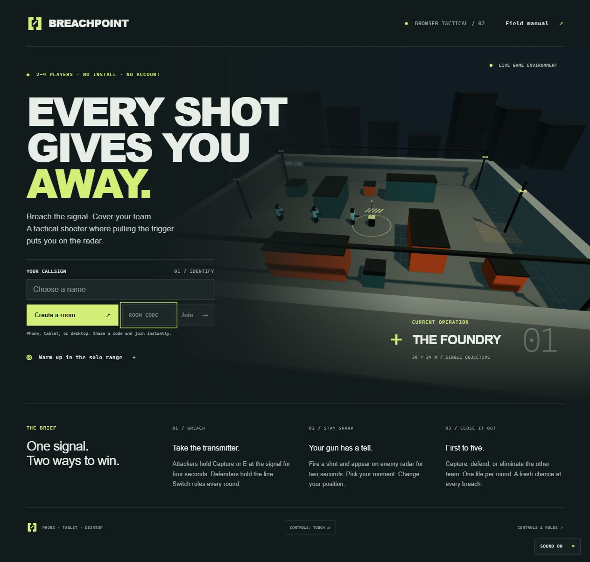

  

<h1 align="center">BREACHPOINT</h1>

<strong>Every shot gives you away.</strong>

A 2–4 player tactical shooter where pulling the trigger briefly puts you on the enemy radar. 
Runs in the browser, as a Windows desktop app, and with touch controls on phones and tablets.

  <a href="https://breachpoint-giaco.justpig133.chatgpt.site"><strong>▶ Play in your browser</strong></a>
  &nbsp;·&nbsp;
  <a href="https://breachpoint-giaco.justpig133.chatgpt.site/api/download">Download for Windows</a>
  &nbsp;·&nbsp;
  <a href="https://breachpoint-giaco.justpig133.chatgpt.site/guide">Field manual</a>

---

## The idea

Most shooters reward the first shot. Breachpoint charges you for it.

Firing reveals your position on the opposing radar for two seconds. Knowing that, engagements stop being a reflex test and become a negotiation with yourself: is this kill worth being seen? Change position, hold the angle, or take the shot and dare the other team to act on the tell.

No game account is required. A room code works across every platform, so a desktop host can play with a phone and a browser with one click.

## Modes

**Breach** — 2–4 players alternate between attacking and defending a transmitter. Take it, hold it, or wipe the other team; the first side to five rounds wins. Downed teammates can be revived, so a lost fight is not always a lost round.

**Last Stand** — 2–8 survivors scavenge, the zone shrinks, and the last player standing takes it.

**Solo PvE** — harmless target practice, timed elimination drills, or five survival waves. Three bot difficulties, configurable maps and equipment, and optional supply drops.

## Content

Ten operators, each with an equipment-based passive trait and a timed ability, viewable as a rotating 3D model before deployment. Thirteen weapons in independent primary and secondary slots, with an inspection screen that reports the numbers the game actually uses: range, head/body/leg damage, magazine size, optics and handling.

Five maps: **Foundry**, **Harbor**, **District**, **Outpost** and **Canopy**. Private hosts pick the map; public Last Stand draws a shared random one.

## Play anywhere

Keyboard and mouse support WASD movement, direct aiming, hold or toggle scoping and full rebinding. Touch controls adapt to portrait and landscape, so the same match works on a phone. Graphics presets, adaptive resolution and frame caps keep the frame budget honest on modest hardware, and the audio mixes stereo gunfire, staged reloads and surface-specific footsteps with separate menu music volume.

The Windows build is a self-contained Electron app with maps and training bundled, so single-player and the range work offline; multiplayer needs a connection. Mac (Intel and Apple Silicon) and Linux (x64 and ARM64) archives exist as unsigned, unnotarized previews.

## Under the hood

One renderer — React and Three.js — runs in both the browser and the Electron shell. A Cloudflare Worker with D1 coordinates rooms and matchmaking. During a match, one active player simulates the game authoritatively while WebRTC data channels carry inputs and snapshots, falling back to an HTTPS relay when a peer link cannot be established. Untrusted commands are normalized at both the network and simulation boundaries.

## Honest limits

Breachpoint is a casual multiplayer game, not an esports platform. There is no host migration, no dedicated simulation server, no competitive anti-cheat and no persistent progression. Refreshing a client does not restore its session, and the host should stay open and visible during a match. Native launch and gameplay testing on Mac and Linux is still pending.

## About this repository

This is a showcase repository: it contains no source code, build scripts or assets beyond the cover art and logo. The implementation lives in a private repository. Questions, bug reports and feedback are welcome in [Issues](../../issues).

## Credits

Created and creatively directed by **Giacomo Albergo**. Art, models, maps, effects and audio are procedural project assets produced with AI assistance under the creator's direction. Third-party runtime software — Electron, Chromium, React and Three.js — remains under its original authors' licenses.

© 2026 Giacomo Albergo. All rights reserved.
